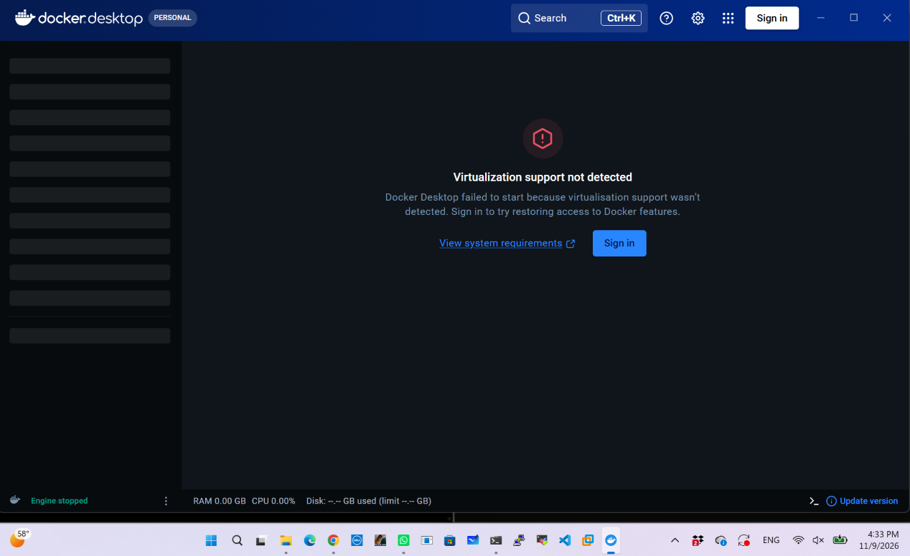
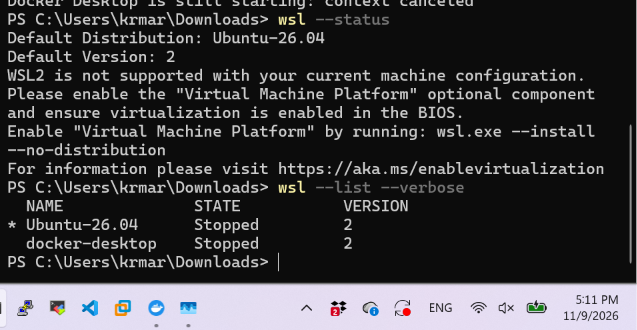
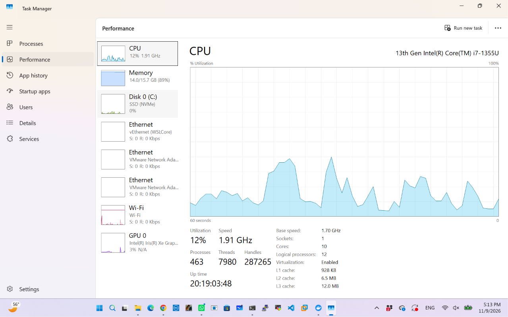
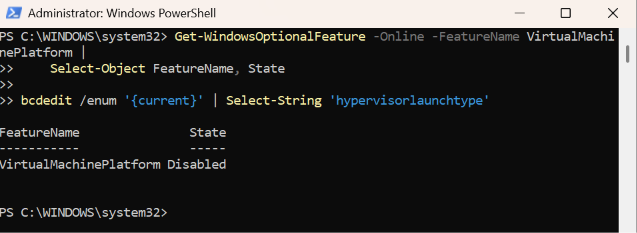
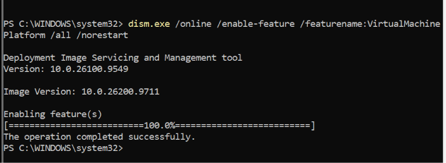
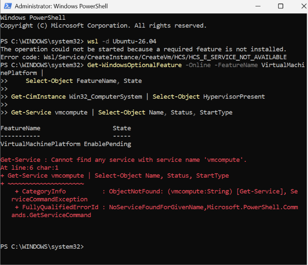
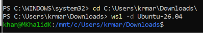
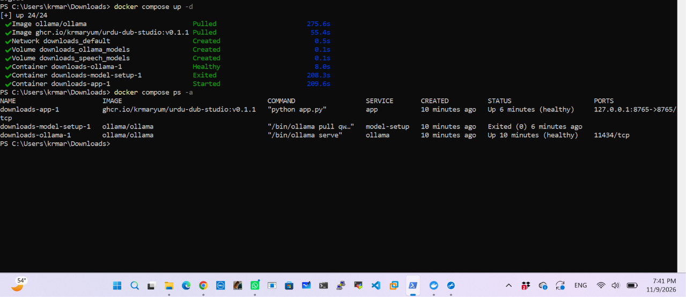

# Urdu Dub Studio installation troubleshooting

## Desktop · Missing Windows feature

Docker Desktop setup reported that **Virtual Machine Platform** was missing. Enabling the feature and restarting Windows allowed the installer to report success. A later PowerShell session could not find `docker`. If you encounter that, reopen PowerShell, run `Get-Command docker`, and use `docker version` to check the **Server** section. The desktop engine result was not captured in these notes.

## Dell laptop · WSL and Docker recovery

### 1. Identify the error

Docker Desktop showed **Virtualization support not detected**. PowerShell could not connect to the `dockerDesktopLinuxEngine` named pipe. Running `wsl --status` showed that WSL 2 could not start under the current Windows configuration.





### 2. Check firmware and Windows separately

Open **Task Manager → Performance → CPU**. On this Dell, **Virtualization** already showed **Enabled**. The Windows feature was still **Disabled**. Check it from **PowerShell as Administrator**:

```powershell
Get-WindowsOptionalFeature -Online -FeatureName VirtualMachinePlatform |
    Select-Object FeatureName, State
```





### 3. Enable the feature and restart Windows

Run this in **Administrator PowerShell** if the feature is disabled:

```powershell
dism.exe /online /enable-feature /featurename:VirtualMachinePlatform /all /norestart
```

DISM reported success, and the feature showed **EnablePending**. Ubuntu still returned `HCS_E_SERVICE_NOT_AVAILABLE` at that point. Save your work and restart Windows to complete the change.





[Microsoft WSL installation and restart instructions](https://learn.microsoft.com/windows/wsl/install-manual#step-3---enable-virtual-machine-feature)

### 4. Verify Ubuntu and Docker

After restarting, open PowerShell and run `wsl --list --verbose` to find your distro name. On this Dell, the following command opened Ubuntu successfully:

```powershell
wsl -d Ubuntu-26.04
```

Type `exit` to return to PowerShell. Open Docker Desktop and wait for **Engine running**, then run `docker info` and check the **Server** section. Docker was unavailable inside this Ubuntu shell, so the Dell test used Windows PowerShell. If you want to run Docker commands inside Ubuntu, enable that distro in **Docker Desktop → Settings → Resources → WSL Integration**. [Docker WSL integration guide](https://docs.docker.com/desktop/features/wsl/use-wsl/)



### 5. Verify Urdu Dub Studio

Save the release's `compose.yaml` in a folder you can find again. In PowerShell, go to that folder. On the Dell it was Downloads:

```powershell
cd "$env:USERPROFILE\Downloads"
docker compose up -d
docker compose ps -a
```

The Dell output showed **app healthy**, **Ollama healthy**, and **model-setup Exited (0)**. The earlier screenshot showed the app had started. The final screenshot confirms that it passed its health check.



[Urdu Dub Studio v0.1.1 release and Compose file](https://github.com/krmaryum/urdu-dub-studio/releases/tag/v0.1.1)

### 6. Run a short YouTube test

Open [Urdu Dub Studio](http://localhost:8765). Use the [YouTube link shared for the Dell test](https://youtu.be/KZXYTYwPrAA) if you have permission and the video is accessible. A short English clip you own is another suitable test input. Play the Urdu audio and download the Roman Urdu transcript. The evidence here verifies container health. Record the dub result separately.

## Repo placement

Copy the entire extracted folder into `docs/` so the relative image links keep working. Link this guide and the Roman Urdu guide from `docs/troubleshooting.md`.
