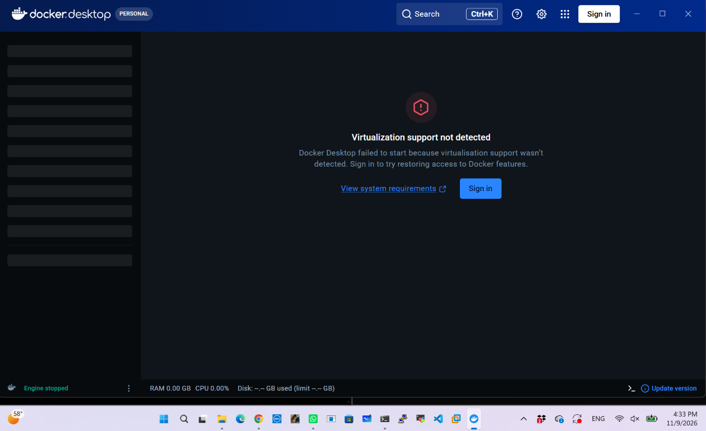
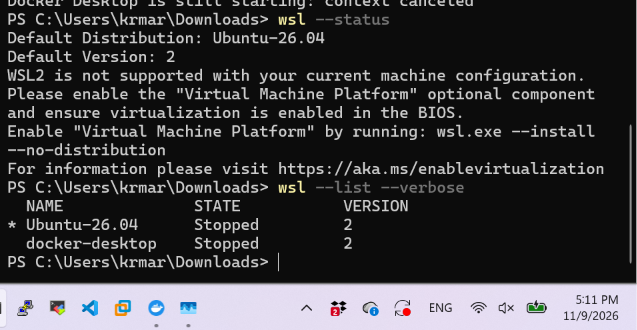
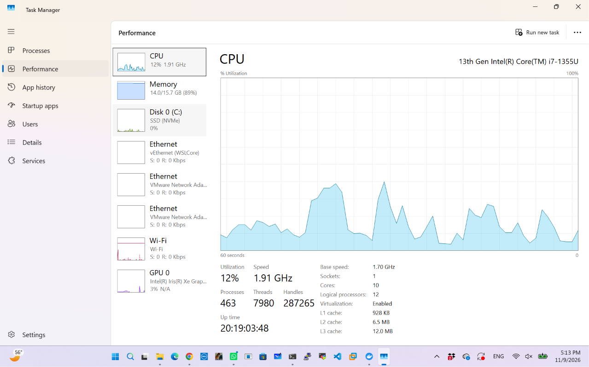
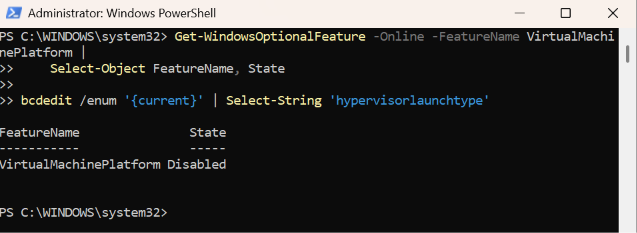
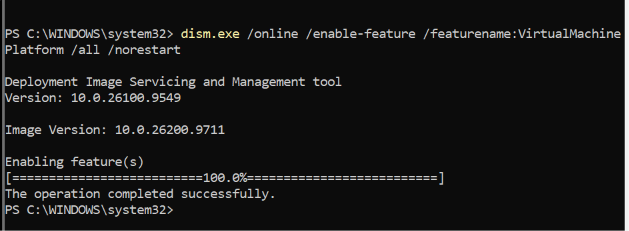
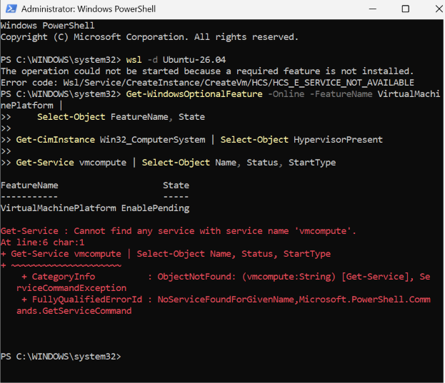
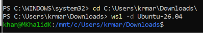
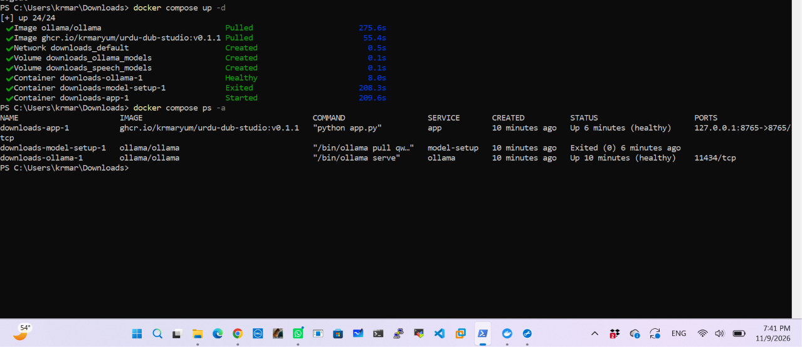

# Urdu Dub Studio installation ke masail

## Desktop · Windows ka zaroori feature band tha

Docker Desktop setup ne bataya ke **Virtual Machine Platform** maujood nahi tha. Feature enable karke Windows restart kiya, phir installer ne kamyabi dikhai. Baad mein PowerShell ko `docker` command nahi mili. Agar aisa ho, naya PowerShell kholein, `Get-Command docker` chalayein, phir `docker version` ke **Server** section ko check karein. Is desktop ka aakhri engine test in notes mein record nahi hua.

## Dell laptop · WSL aur Docker dobara chalayein

### 1. Error pehchanein

Docker Desktop par **Virtualization support not detected** aaya. PowerShell `dockerDesktopLinuxEngine` named pipe se connect nahi kar saka. `wsl --status` ne bataya ke maujooda Windows configuration mein WSL 2 start nahi ho raha tha.





### 2. Firmware aur Windows ki setting alag check karein

**Task Manager → Performance → CPU** kholein. Is Dell par **Virtualization** pehle se **Enabled** thi, lekin Windows ka feature **Disabled** tha. **PowerShell as Administrator** khol kar ye command chalayein:

```powershell
Get-WindowsOptionalFeature -Online -FeatureName VirtualMachinePlatform |
    Select-Object FeatureName, State
```





### 3. Feature enable karein aur Windows restart karein

Agar feature disabled ho, **Administrator PowerShell** mein ye command chalayein:

```powershell
dism.exe /online /enable-feature /featurename:VirtualMachinePlatform /all /norestart
```

DISM ne kamyabi dikhai aur feature **EnablePending** ho gaya. Us waqt Ubuntu ab bhi `HCS_E_SERVICE_NOT_AVAILABLE` de raha tha. Apna kaam save karein aur Windows restart karein taake feature poori tarah enable ho jaye.





[Microsoft ki WSL installation aur restart ki hidayaat](https://learn.microsoft.com/windows/wsl/install-manual#step-3---enable-virtual-machine-feature)

### 4. Ubuntu aur Docker check karein

Restart ke baad PowerShell kholein aur distro ka naam dekhne ke liye `wsl --list --verbose` chalayein. Is Dell par is command se Ubuntu khul gaya:

```powershell
wsl -d Ubuntu-26.04
```

PowerShell mein wapas aane ke liye `exit` likhein. Docker Desktop kholein, **Engine running** ka intezar karein, phir `docker info` mein **Server** section check karein. Is Ubuntu shell ke andar Docker command dastiyab nahi thi, is liye Dell ka test Windows PowerShell se kiya. Agar Ubuntu ke andar Docker chalana ho, **Docker Desktop → Settings → Resources → WSL Integration** mein apni distro enable karein. [Docker ki WSL integration guide](https://docs.docker.com/desktop/features/wsl/use-wsl/)



### 5. Urdu Dub Studio check karein

Release ka `compose.yaml` kisi aise folder mein save karein jo aap dobara dhoond sakein. PowerShell mein usi folder mein jayein. Dell par file Downloads mein thi:

```powershell
cd "$env:USERPROFILE\Downloads"
docker compose up -d
docker compose ps -a
```

Dell ke output mein **app healthy**, **Ollama healthy**, aur **model-setup Exited (0)** tha. Pehli screenshot mein app start hui thi. Aakhri screenshot dikhati hai ke app ka health check bhi pass hua.



[Urdu Dub Studio v0.1.1 release aur Compose file](https://github.com/krmaryum/urdu-dub-studio/releases/tag/v0.1.1)

### 6. Chhoti YouTube video se test karein

[Urdu Dub Studio](http://localhost:8765) kholein. Agar video khul rahi ho aur aap ko ijazat ho to [Dell test ke liye share kiya gaya YouTube link](https://youtu.be/KZXYTYwPrAA) use karein. Apni chhoti English clip bhi test ke liye use kar sakte hain. Urdu audio chala kar dekhein aur Roman Urdu transcript download karein. In screenshots se containers ka health check verify hota hai. Dub ka result alag record karein.

## Repo mein jagah

Poora extracted folder `docs/` mein copy karein taake screenshots ke relative links chalti rahein. Dono guides ke links `docs/troubleshooting.md` mein add karein.
